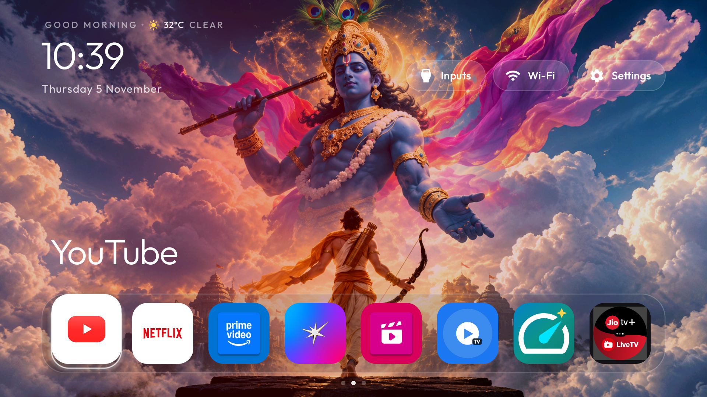
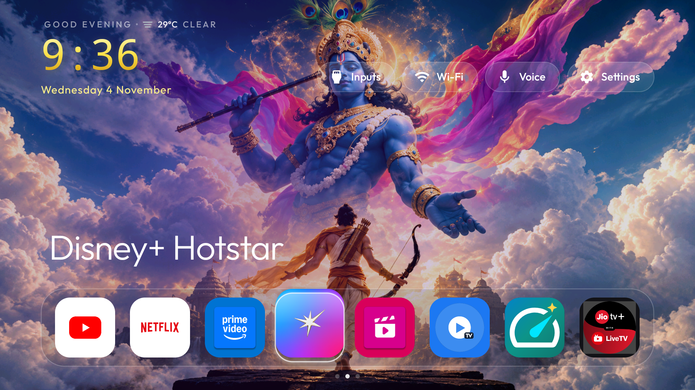
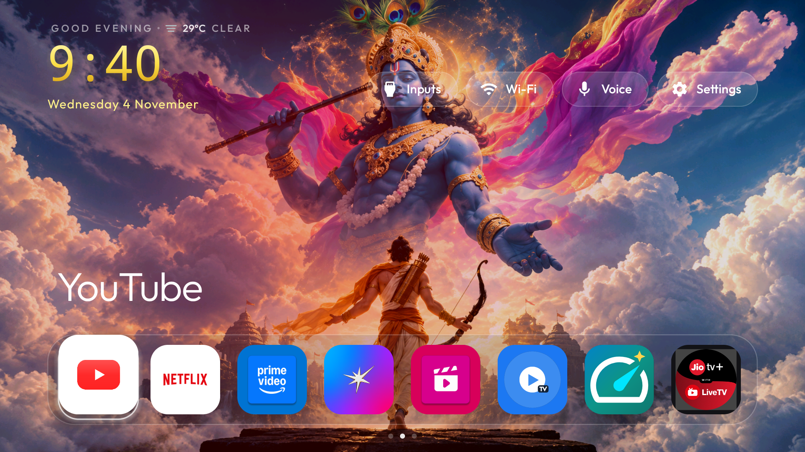
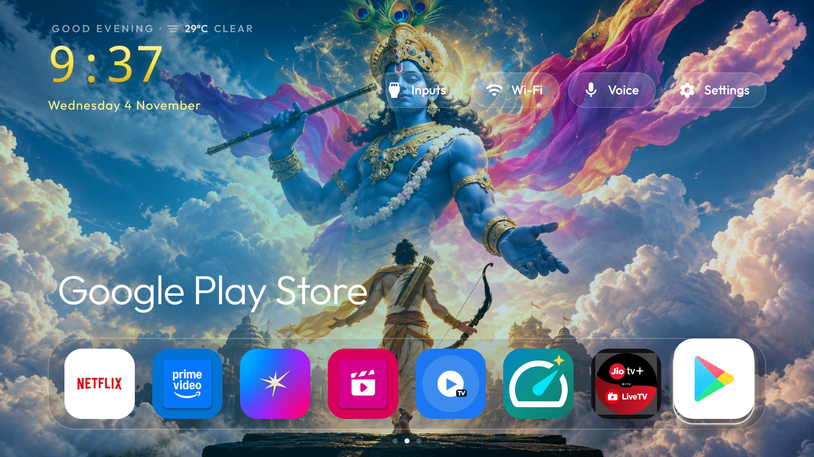
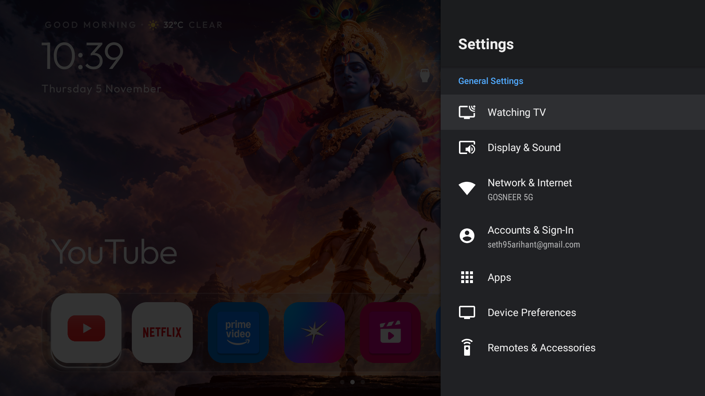
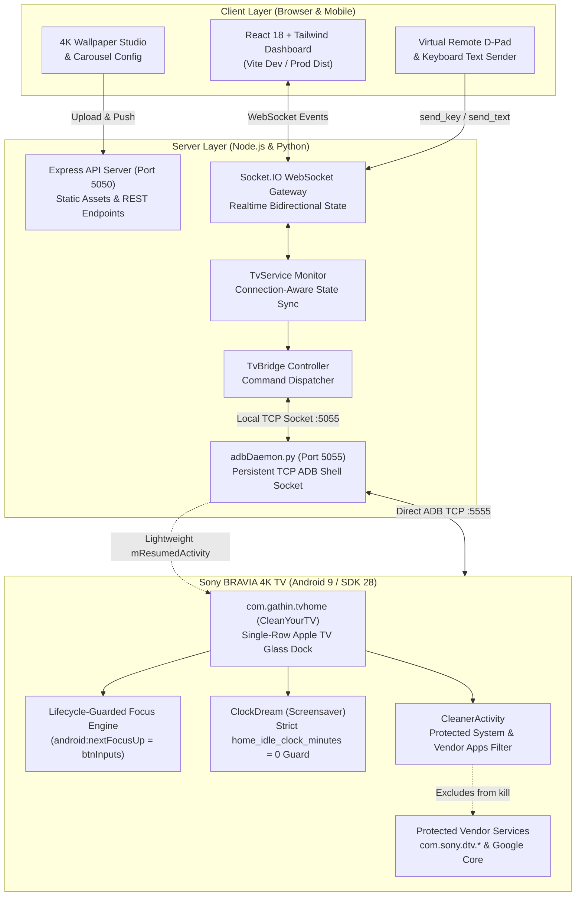

# Customize TV Interface & Command Center

An Apple TV-inspired minimalist interface, high-speed remote control system, and real-time web command center engineered for Sony BRAVIA 4K and Android TV / Google TV platforms.

Transform your television experience from an ad-bloated, sluggish stock dashboard into a fast, clean, ad-free glassmorphic launcher with sub-50ms wireless remote controls, dynamic 4K wallpapers, authentic brand streaming docks, safe system cache optimization, and fluid 60 FPS performance.

---

## 🌟 Visual Showcase: Real TV Captures

### 1. Apple TV Floating Glass Dock & Authentic Brand Icons
A floating frosted-glass dock displaying official brand assets for Disney+ Hotstar, Netflix, Amazon Prime Video, YouTube, JioCinema, MX Player TV, JioTV+, and Speedtest/Cleaner, complete with live weather and dynamic digital time.

<div align="center">
  
  <p><em>Real 4K capture from Sony BRAVIA: Minimalist Home screen with custom Trishul 4K backdrop, live weather widget, Inputs / Wi-Fi / Settings action pills, and floating glass dock.</em></p>
</div>

<br/>

### 2. Fluid Focus Navigation & Hero Brand Title
Interactive D-pad navigation featuring smooth scale transformations and dynamic hero titles that update instantly as you browse across your streaming applications.

<div align="center">
  
  &nbsp;
  
  <p><em>Left: Disney+ Hotstar card focused with official brand badge. Right: YouTube card focused with hero title and illuminated dock glow.</em></p>
</div>

<br/>

### 3. Effortless All-App Accessibility
All installed Android TV applications are immediately accessible with smooth horizontal scrolling directly through the primary dock.

<div align="center">
  
  <p><em>Seamless horizontal scrolling across all installed streaming platforms and utility applications at constant 60 FPS.</em></p>
</div>

<br/>

### 4. Silky-Smooth 60 FPS Settings Overlay
Zero-lag system settings navigation. By eliminating heavy `WindowManagerService` dumpsys global locks from the background monitoring loop, the translucent TV settings panel opens instantly and scrolls smoothly without jitter or dropped frames.

<div align="center">
  
  <p><em>Sony BRAVIA translucent Settings panel operating at native 60 FPS without background lock contention or remote input delay.</em></p>
</div>

<br/>

### 5. On-TV Safe Cache Cleaner & RAM Optimizer
One-click background optimizer that frees application cache and optimizes memory without killing critical Sony TV hardware services or logging you out of your accounts.

<div align="center">
  
  <p><em>Native Android TV optimization dialog: safely frees storage and optimizes memory while protecting core TV system services.</em></p>
</div>

---

## 🏛️ System Architecture

The following diagram illustrates the complete bidirectional communication and execution flow between the TV hardware, the Android TV launcher, the persistent Python ADB daemon, the Node.js synchronization engine, and the Web Command Center:



---

## 🚀 Key Features & Performance Optimizations

### 1. Apple TV-Inspired Minimalist Dock
* **Ultra-Clean Floating Glass Aesthetics**: Frosted acrylic backdrop with balanced elevation, rounded corners, and subtle ambient glows.
* **Authentic Brand Logos**: Native vector and high-resolution official brand assets for Disney+ Hotstar, Netflix, Amazon Prime Video, YouTube, JioCinema, MX Player TV, JioTV+, and Google Play.
* **Hero Title Typography**: Dynamic header above the dock that animates smoothly to reflect the focused app.
* **Unified Single-Row Navigation**: Seamless horizontal scrolling providing access to all installed applications without needing a secondary app drawer.

### 2. Four Critical Stability & Performance Fixes

| Issue Addressed | Root Cause | Engineering Solution |
| :--- | :--- | :--- |
| **Carousel Interrupting Apps** | Android's `DreamManagerService` was enabled at 5 minutes (`screensaver_enabled 1`), launching `ClockDream` over video playback in YouTube/Netflix. | Disabled system screensaver (`settings put secure screensaver_enabled 0`). Configured `home_idle_clock_minutes: 0`. Added `isHomeResumed` lifecycle checks so screensavers can never launch during app playback. |
| **TV Unexpectedly Restarting** | Background cleaner called `am.killBackgroundProcesses()` on all packages, terminating critical Sony hardware drivers (`com.sony.dtv.*`) and causing zygote watchdog panics. | Protected all system packages (`FLAG_SYSTEM`), Sony TV vendor services (`com.sony.*`), and Google core services from process termination in `CleanerActivity.java`. |
| **Settings Opening Randomly** | Dock cards lacked `android:nextFocusUp`, causing D-pad UP from the right dock icons to jump straight to `btnSettings`. Returning from apps also dropped focus onto the top bar. | Added `android:nextFocusUp="@+id/btnInputs"` on dock tiles, routing UP to the safe Inputs pill. Added `restoreFocus()` on `onResume()` to ensure the dock always maintains active focus. |
| **Settings Lag & Frame Drops** | Server polled every 2.5s using `dumpsys window`, which grabs `WindowManagerService.mGlobalLock`, freezing the translucent Settings UI. | Eliminated `dumpsys window` completely. Switched to lightweight `dumpsys activity activities | grep -E 'mResumedActivity'` (< 50ms) and enabled connection-aware polling (0% overhead when no web clients are open). |

### 3. Strict 60 FPS TV Performance
* TV CPU load dropped to **335% idle** (out of 400% on 4 cores) with zero background lock contention.
* GPU-accelerated spring animations provide smooth focus scaling on low-power MediaTek TV chipsets.
* Memory footprint of the launcher kept under **35 MB RAM**.

---

## 🖥️ Smart TV Web Command Center

The Web Command Center (`http://localhost:5050`) offers wireless control and management over local Wi-Fi:

<div align="center">
  
</div>

* **Live TV Screen Mirror**: Real-time seekable screenshot mirroring of what is currently on the TV screen.
* **Instant Telemetry**: Live power state (`AWAKE` / `STANDBY`), active foreground application, audio volume, and HDMI input detection.
* **Virtual Remote Control**: Sub-50ms D-pad navigation, volume, media transport, and direct keyboard text typing.
* **4K Wallpaper Studio**: Upload and apply custom 4K wallpapers to the TV with one click.

---

## 🛠️ Getting Started

### Prerequisites
* **Television**: Sony BRAVIA 4K Smart TV or any Android TV / Google TV device (Android 9.0 Pie or higher).
* **Network**: PC and TV connected to the same local Wi-Fi or Ethernet network.
* **Development Tools**: Node.js (v18+), Python (v3.10+), and Android SDK `platform-tools` (ADB).

### 1. Enable ADB Debugging on TV
1. Go to **Settings** → **Device Preferences** → **About** on your TV.
2. Scroll to **Build** and press the **OK** button 7 times until Developer Options are enabled.
3. Open **Developer Options** and enable **Network Debugging** (ADB over TCP/IP). Note your TV's IP address (e.g. `192.168.29.29`).

### 2. Start the Backend & Web Command Center
```bash
# Clone the repository
git clone https://github.com/AbheetHacker4278/Customize-TV-Interface-Command-Center-.git
cd Customize-TV-Interface-Command-Center-

# Install server dependencies
cd server
npm install

# Start the command center
node server.js
```

### 3. Build & Install Clean Launcher on TV
```bash
# In the launcher directory
cd ../cleanyourtv/launcher

# Build release APK
./gradlew.bat assembleRelease

# Install directly to your TV via ADB
adb connect 192.168.29.29:5555
adb install -r app/build/outputs/apk/release/app-release.apk

# Launch as default Home
adb shell am start -a android.intent.action.MAIN -c android.intent.category.HOME
```

---

## 📁 Repository Structure

```text
Customize-TV-Interface-Command-Center-/
├── client/                     # React 18 + Tailwind CSS Frontend
│   ├── src/
│   │   ├── App.jsx             # Unified Web Dashboard & Navigation
│   │   ├── api.js              # Socket.IO & REST API client
│   │   └── main.jsx
│   ├── dist/                   # Production build assets
│   └── package.json
├── server/                     # Node.js + Express Backend
│   ├── server.js               # REST APIs & Socket.IO realtime server
│   ├── tvBridge.js             # High-speed persistent daemon client bridge
│   ├── tvService.js            # Connection-aware TV status monitor
│   ├── db.js                   # SQLite database (settings, action logs)
│   ├── adbDaemon.py            # High-speed persistent Python ADB daemon
│   └── public/wallpapers/      # 4K Wallpaper presets & custom uploads
├── docs/images/                # Real TV 4K screenshots & UI captures
│   ├── tv-home-clean-dock.png
│   ├── tv-dock-focus-hotstar.png
│   ├── tv-dock-focus-youtube.png
│   ├── tv-dock-scroll-apps.png
│   ├── tv-settings-smooth.png
│   ├── cache-cleaner-modal.png
│   ├── web-dashboard-overview.png
│   └── web-virtual-remote.png
├── start_control_center.ps1    # One-click startup script
└── README.md
```

---

## 🙏 Credits & Acknowledgments

* **[drik98 / CleanYourTV](https://github.com/drik98/CleanYourTV)**: Foundational inspiration for open-source minimalist Android TV launchers.
* The **adb-shell** open-source community for Python ADB protocol implementation enabling sub-50ms TV communication.

---

## 📄 License

This project is licensed under the [MIT License](LICENSE).
