# Customize-TV-Interface-Command-Center-

An Apple TV-inspired minimalist interface, high-speed remote control system, and web-based command center for Android TV and Sony BRAVIA 4K Smart TVs.

Transform your television experience from an ad-bloated, sluggish stock dashboard into a fast, clean, ad-free glassmorphic launcher with sub-50ms wireless remote controls, dynamic 4K wallpapers, an auto-fading screensaver carousel, and a native TV cache cleaner.

---

## 🌟 Visual Showcase: Before & After

### The Transformation

| Stock Android TV / Google TV (Before) | Customize TV Command Center (After) |
| :--- | :--- |
| 🚫 Intrusive sponsored ads & video trailer autoplays | ✨ **Zero ads, 100% clean visual focus** |
| 🚫 Sluggish, heavy UI eating 1.3 GB+ RAM at idle | ⚡ **Ultra-lightweight native launcher with fluid 60 FPS spring physics** |
| 🚫 Generic, unchangeable cluttered home feed | 🎨 **Apple TV-styled floating glass dock with custom 4K wallpapers** |
| 🚫 Apps continuously accumulating cached junk | 🧹 **One-click on-TV Auto Cache & RAM Optimizer** |
| 🚫 Remote app limited to IR or slow TV manufacturer apps | 🕹️ **Persistent sub-50ms Web Remote & Automation Dashboard** |
| 🚫 Fixed screensaver with burn-in risk | 🌊 **Cinematic 5-Minute Inactivity Auto Carousel with smooth faded cross-fades** |

---

### Home Screen & Day/Night Themes

<div align="center">
  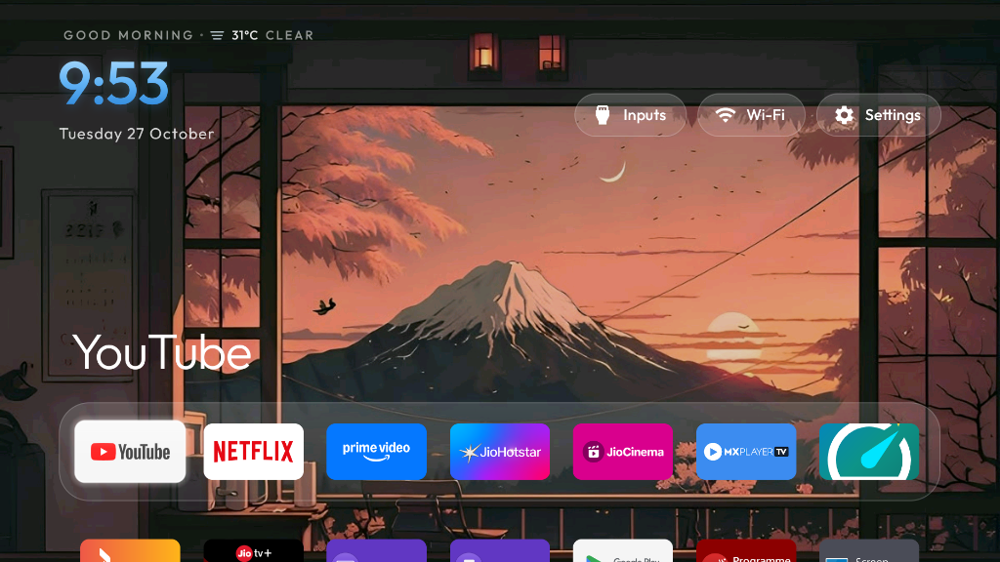
  <p><em>Daytime: Mount Fuji Sunset 4K Wallpaper, live weather forecast, and floating glass dock with large focused dock title.</em></p>
</div>

<br/>

<div align="center">
  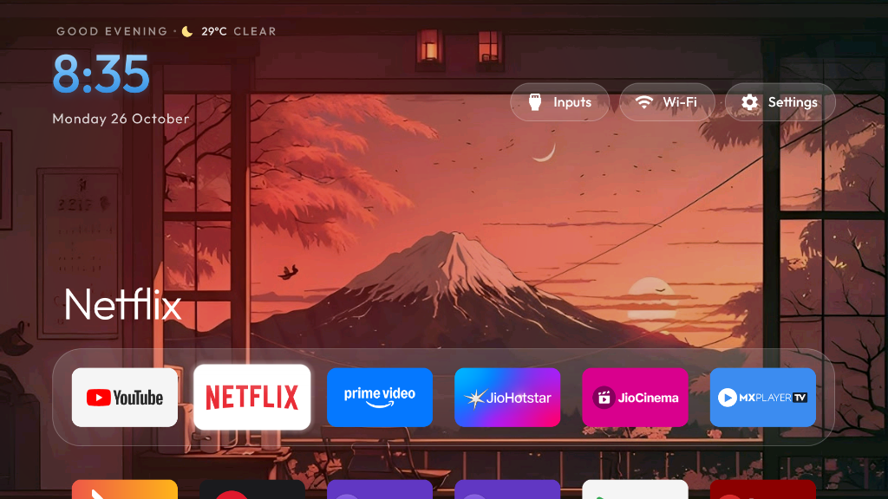
  <p><em>Night Mode: Ambient twilight grade, dynamic time and evening weather pill with focused tile lighting.</em></p>
</div>

---

### On-TV Auto Cache Cleaner & Memory Optimizer

<div align="center">
  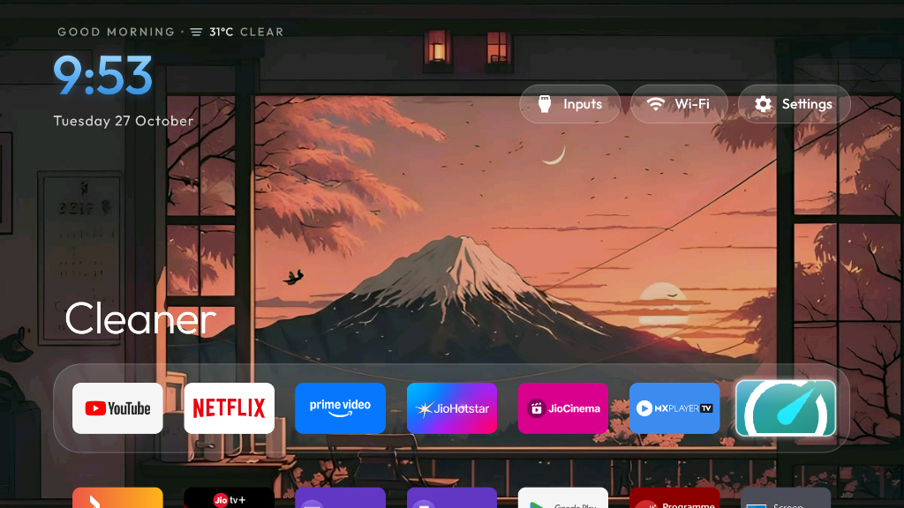
  <p><em>One-click cleaner application natively accessible directly from your primary Home dock.</em></p>
</div>

<br/>

<div align="center">
  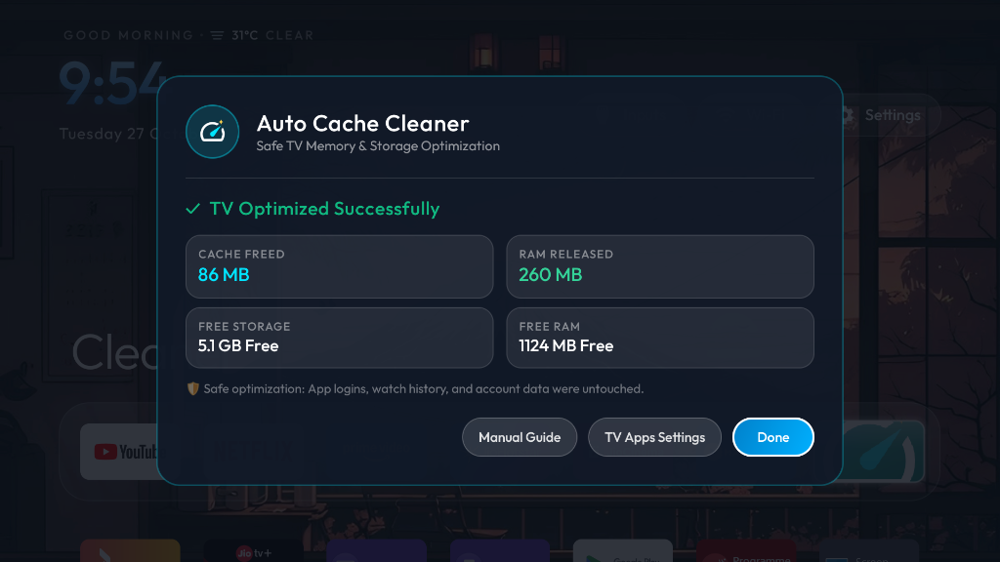
  <p><em>Native Android TV optimization dialog: instantly releases RAM and frees background cache without logging you out of streaming services.</em></p>
</div>

<br/>

<div align="center">
  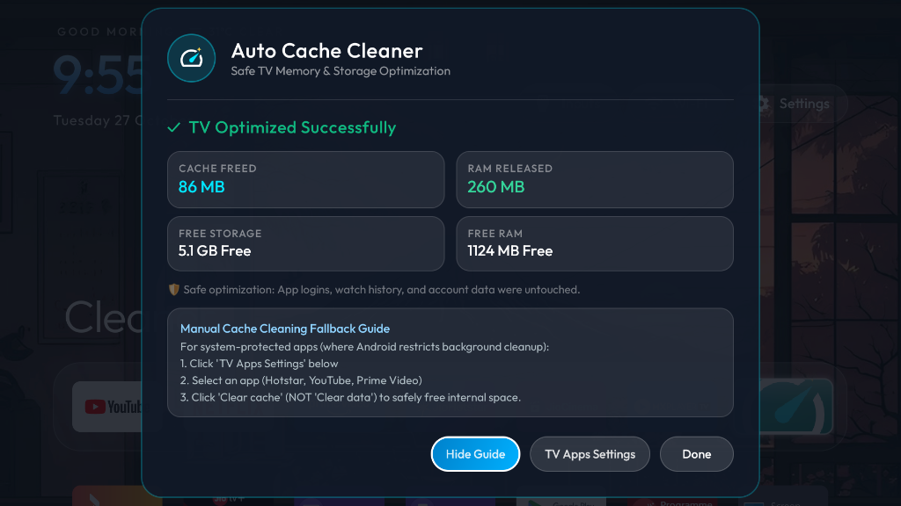
  <p><em>Integrated fallback guide for clearing cache in protected system applications with one-click deep link to Android TV settings.</em></p>
</div>

---

## 🖥️ Smart TV Web Command Center Interface

The Web Command Center (`http://localhost:5050` or accessible over local Wi-Fi from your smartphone/tablet) gives you full telemetry, bidirectional synchronization, and instant wireless control over your television.

### 1. Live System Dashboard

<div align="center">
  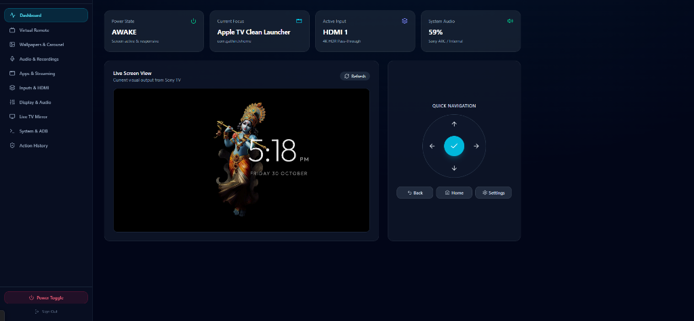
</div>

* **Live TV Screen Mirror**: Real-time seekable screenshot mirroring of what is currently playing on the TV screen.
* **Instant Telemetry Cards**:
  * **Power State**: Real-time `AWAKE` or `STANDBY` detection via Android power wakefulness dumps.
  * **Current Focus**: Displays currently focused Android activity (e.g. `Apple TV Clean Launcher`).
  * **Active Input**: Identifies active HDMI source and 4K HDR pass-through status.
  * **System Audio**: Volume percentage with Sony ARC / Internal speaker audio routing indicator.
* **Quick Navigation D-Pad**: High-speed directional controls (`Up`, `Down`, `Left`, `Right`, `OK`, `Back`, `Home`, `Settings`).

---

### 2. Virtual Remote & Voice Assistant Engine

<div align="center">
  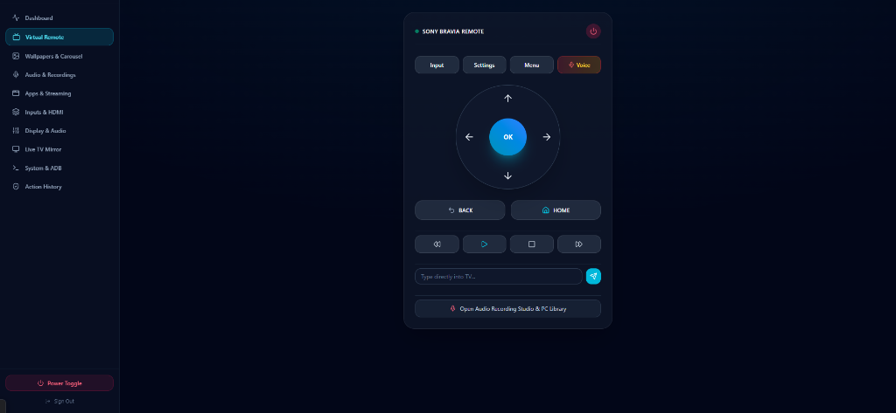
</div>

* **Sub-50ms Key Injection**: Communicates over an open persistent TCP socket with the Python `adbDaemon` worker.
* **Voice Assistant Injection**: Dedicated `Voice` button injecting native `KEYCODE_VOICE_ASSIST` (Keycode 231) to trigger Android TV voice search without physical remote access.
* **Direct Text Typing**: Type search queries, URLs, passwords, or usernames directly from your PC/phone keyboard and send them to the TV's active text field.
* **Media Transport Bar**: Play, Pause, Stop, Seek Rewind, and Fast-Forward controls.

---

### 3. Sony BRAVIA 4K Wallpaper Studio & Auto Screen Carousel

<div align="center">
  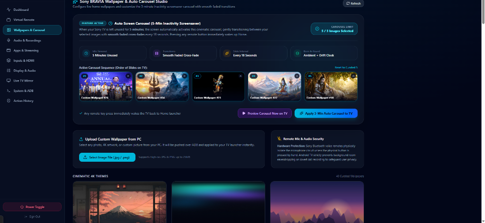
</div>

* **Auto Screen Carousel (5-Min Inactivity Screensaver)**:
  * **5-Minute Idle Auto-Start**: Automatically triggers after 5 minutes of TV inactivity without remote clicks.
  * **Smooth Faded Cross-Transitions**: Hardware-accelerated dual-alpha animation transitions images smoothly every 18 seconds without screen flicker or sudden cuts.
  * **Strict 5-Image Maximum**: Sequence visualizer displaying `Slot #1` through `Slot #5` in real time.
  * **Burn-In Guard**: Floating ambient gradient and moving clock protect OLED and LCD displays.
  * **Instant Preview**: "Preview Carousel Now on TV" button to test the transition sequence immediately.
* **Custom Wallpaper Upload from PC**: Upload any 4K photograph or digital artwork from your PC. Automatically optimized, pushed to the TV, and added to your persistent gallery.
* **Remote Mic & Hardware Privacy**: Explains the physical push-to-talk isolation in Sony Bluetooth voice remotes, ensuring no background listening.

---

### 4. TV Home Screen Clock Face Studio (Native Launcher Integration)

<div align="center">
  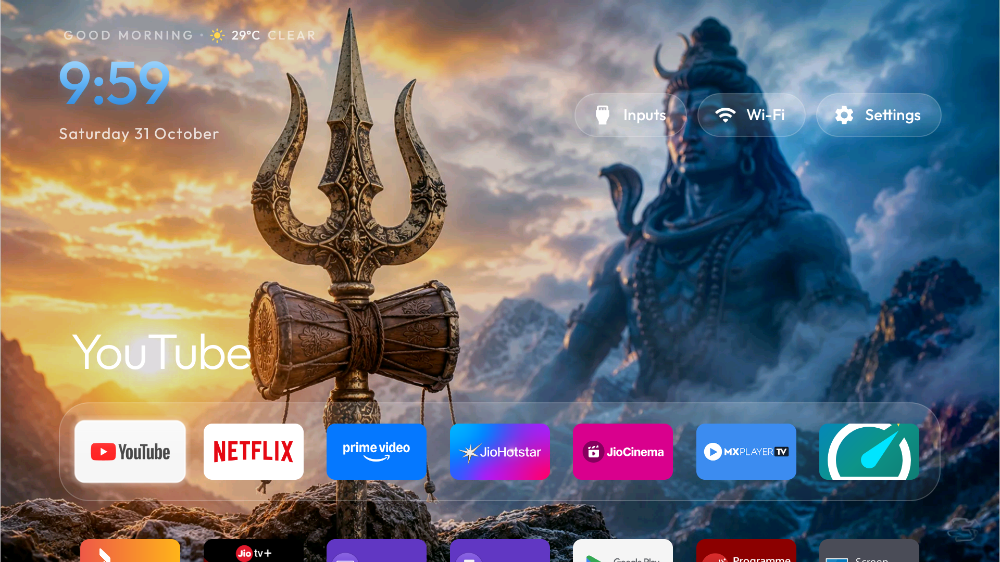
  <p><em>Real live capture from Sony BRAVIA 4K: Top-left clock customized with Apple TV Sky Cyan linear gradient shaders, custom typography, date styling, and ambient weather pill.</em></p>
</div>

* **No Browser App Required**: Directly customizes the native top-left clock on the Android TV Home Screen (`com.gathin.tvhome`).
* **Interactive Live TV Preview**: A real-time web simulator replicating the exact Sony TV home screen layout (clock, weather greeting, date, top action bar, focused dock app title, floating glass dock).
* **Curated Visual Themes**:
  * *Apple TV Sky Cyan* (Smooth 3-stop linear gradient shader)
  * *Golden Amber Sunset* (Warm sunset gold gradient)
  * *Minimal Platinum White* (Clean high-contrast minimalism)
  * *Cyberpunk Neon Glow* (High-saturation cyan/magenta with neon glow shadows)
  * *Emerald Aurora Mint* (Lush Nordic aurora borealis)
  * *Ruby Crimson Fire* (Vibrant scarlet fire gradient)
  * *Amethyst Royal Purple* (Deep royal violet)
  * *Monospace Tech Matrix* (Terminal font styling)
  * *Classical Roman Serif* (Elegant serif typography)
* **Granular Typography & Layout Controls**:
  * Real-time SP sizing slider (40sp to 90sp).
  * System Typefaces (Light, Medium, Bold, Monospace, Serif).
  * 3-Stop Linear Gradient Shaders (`colorTop`, `colorMid`, `colorBottom`) rendered natively in Android canvas.
  * Drop shadow color and blur radius.
  * Seconds display toggle (`HH:mm:ss`), 12h / 24h format switcher.
  * Date display toggle and custom date color (`dateColor`).
  * Greeting / Weather row toggle (`showGreeting`).
* **Sub-Second Native TV Apply**:
  * Pushes persistent JSON configuration directly to `/sdcard/Android/data/com.gathin.tvhome/files/config.json`.
  * Restarts launcher seamlessly in under 300ms without leaving the TV Home screen.
  * Retains applied design across TV reboots and power cycles.

---

### 5. Installed TV Applications & Streaming Hub

<div align="center">
  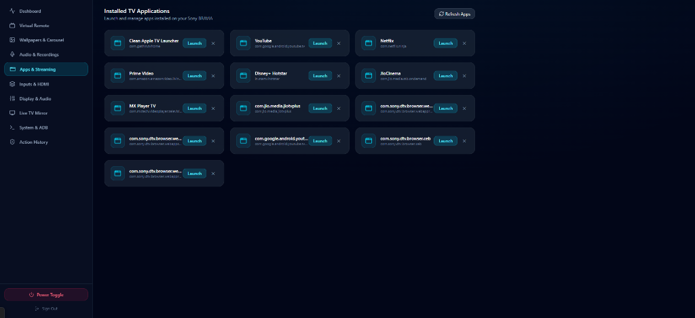
</div>

* **Live App Detection**: Scans 3rd party Leanback applications and system media players.
* **One-Click Launch & Close**: Instantly start or force-stop streaming apps (YouTube, Netflix, Prime Video, Disney+ Hotstar, JioCinema, MX Player TV, JioTV+, Web Browsers) from your web browser.

---

### 5. Input Source Selection (HDMI / AV)

<div align="center">
  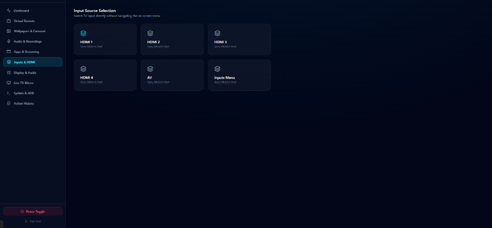
</div>

* **Direct Hardware Switching**: Dedicated buttons for `HDMI 1`, `HDMI 2`, `HDMI 3`, `HDMI 4`, `AV Composite`, and the native Sony BRAVIA `Inputs Menu`.
* Eliminates the need to cycle through sluggish on-screen source lists.

---

## 🏗️ System Architecture


---

## ⚡ Core Features Breakdown

### 1. Web-Based Smart TV Control Center
* **Instant Virtual Remote**: High-speed D-Pad, OK, Back, Home, Menu, Settings, Volume Up/Down/Mute, Power controls.
* **Persistent ADB Daemon**: Uses Python `adb_shell` over a persistent TCP daemon on port 5055, reducing keypress response latency to **<50ms**.
* **Voice Assistant Key Injection**: Triggers TV voice search and Google Assistant using native `KEYCODE_VOICE_ASSIST` (Keycode 231).
* **Live Screen Mirroring**: Captures high-res screen snapshots directly over ADB to monitor TV playback from any room.
* **Remote Shell Terminal**: Full interactive ADB shell console for running commands and inspecting Android system state.

### 2. Sony BRAVIA 4K Wallpaper Studio
* **Curated 4K Themes**: 10 hand-crafted photographic & digital wallpapers (*Mount Fuji Sunset, Northern Lights Aurora, Golden Coast, Autumn Valley, Cyberpunk Metropolis, etc.*).
* **Custom Photo Uploads**: Drag and drop any 4K image (.jpg, .png, .webp) from your PC to upload and push it to your TV screen within seconds.
* **Deterministic Display**: Applied wallpapers stay locked and persisted on your TV screen across reboots and power cycles without unexpected random rotation.

### 3. Auto Screen Carousel (5-Min Inactivity Screensaver)
* **Inactivity Auto-Start**: Automatically triggers after **5 minutes** of no remote button presses (`home_idle_clock_minutes: 5`).
* **Cinematic Faded Transitions**: Smoothly cross-fades between images every 18 seconds using hardware-accelerated dual-alpha animation (`alpha(0f)` $\to$ `alpha(1f)`).
* **Strict 5-Image Maximum**: Multi-select interface in the web dashboard strictly enforces a 5-image sequence limit.
* **Instant Preview & Remote Wake**: Preview the carousel on your TV with a single click in the dashboard; touch any button on your physical remote to instantly return to Home.

### 4. TV Memory Optimizer & Auto Cache Cleaner
* Built directly into the launcher dock as a native Leanback Android activity (`.CleanerActivity`).
* Safely trims background process memory and cleans app temporary cache files.
* Preserves user logins, app sessions, account credentials, and streaming watch history.

### 5. Audio & Voice Recording Studio
* Record notes, calls, or conversations through your browser microphone.
* Recordings are permanently stored on your local PC in `recordings/` and logged in an SQLite database with an integrated HTML5 web player.

### 6. Custom Clock Face Studio & TV Browser Integration
* **7 Distinct Clock Styles**:
  * **Minimal Digital Clock**: Ultra-clean, thin typography with subtle live date.
  * **Swiss Analog Chronograph**: High-precision vector dials with smooth second sweep, customizable hands, and markers (ticks, dots, arabic numbers, roman numerals).
  * **Retro Split-Flap**: Mechanical split-flap cards with textured 3D perspective fold.
  * **Modern Digital Clock**: Glassmorphic dock pill with gradient typography and high legibility.
  * **Futuristic / Neon Clock**: Cyberpunk chromatic glowing text, secondary accent glow, and cathode scanlines.
  * **Minimal Typography Clock**: Editorial luxury serif aesthetic (*Cinzel / Playfair Display*).
  * **Date & Time Dashboard**: Frosted glass widgets with calendar badges and live TV connection telemetry.
* **Pixel-Perfect TV Synchronization**:
  * Renders natively in the existing TV Browser App at `http://<HOST_IP>:5050/tv-clock` without installing extra APKs.
  * **Sub-50ms Live Sync**: Updates instantly over Socket.IO when customized in the Web Studio.
  * **Offline Persistence**: Caches configuration in `localStorage` and SQLite, automatically restoring upon TV reboot or browser reopen.
  * **OLED Anti-Burn-In Protection**: Sub-pixel drift shifts coordinates by $\pm 2$px every 60 seconds.
* **Full Studio Controls**: Typography (8 Google Fonts), weights (300–900), size sliders, solid/gradient colors, neon glow, element toggles (seconds, AM/PM, 12h/24h, date formats), analog markers/hands tuning, custom 4K wallpaper uploads, and backdrop blur.

---

## 🚀 Quickstart Guide

### Prerequisites
1. **Node.js** (v18 or higher)
2. **Python** (v3.9 or higher with virtualenv)
3. **Android TV** (Android 8.0 Pie or newer) with **Developer Options & ADB Debugging enabled**.

### 1. Clone & Setup
```bash
git clone https://github.com/AbheetHacker4278/Customize-TV-Interface-Command-Center-.git
cd Customize-TV-Interface-Command-Center-
```

### 2. Start the Control Center Server
Run the one-click startup script:
```powershell
powershell -ExecutionPolicy Bypass -File start_control_center.ps1
```

Or start manually:
```bash
cd server
npm install
node server.js
```

### 3. Access the Web Dashboard
* **Local Browser:** `http://localhost:5050`
* **Mobile / Local Network:** `http://<YOUR_PC_IP>:5050`
* **Default Dashboard Password:** `bravia2026`

---

## 🔮 AI Voice Assistant for Smart TV (NVIDIA Nemotron 120B)

Integrated Siri-style glowing orb conversational intelligence directly on your Smart TV and in the Web Command Center, powered by the cutting-edge **NVIDIA Nemotron** model (`nvidia/nemotron-3.5-super-vl-120b-a12b`).

<div align="center">
  
  <p><em>Live Sony BRAVIA 4K TV Screen: Centered Siri-style dynamic glowing orb, real-time voice speech transcription, status pill, and remote controls.</em></p>
</div>

<br/>

### Key Highlights

1. **Remote Mic Double-Press Activation**:
   * Activated instantly when the user **presses the microphone button on the TV remote twice** (double-press window `<= 600ms`).
   * Single press passes through or is ignored, completely avoiding false-positive interruptions and stock assistant overlays.
2. **Dynamic 4-State Visual Orb Animation**:
   * **Listening:** Glowing orb pulses reactively to voice audio levels in real time.
   * **Thinking:** 360-degree continuous rotation shimmer with fluid light expansion.
   * **Speaking:** Dynamic wave scaling synchronized with Text-To-Speech (TTS) audio output.
   * **Idle:** Gentle, organic breathing pulsation on pitch-black OLED background.
3. **Smart TV Function Calling & Autonomous Tool Execution**:
   * Nemotron autonomously converts natural voice intents into executable TV actions:
     * *"Open YouTube"* ➔ Dispatches `open_app(YouTube)`.
     * *"Set volume to 25%"* ➔ Dispatches `set_volume(25)`.
     * *"Turn off the screen"* ➔ Dispatches `screen_power(sleep)`.
     * *"Switch to HDMI 1"* ➔ Dispatches `switch_input(HDMI 1)`.
     * *"Clean application cache"* ➔ Clears cache and frees TV RAM safely.
     * *"Change the wallpaper"* ➔ Cycles home screen 4K wallpaper.
4. **Natural Continuous Voice Conversations**:
   * Speech-to-Text (STT) records voice queries on the TV or Web Command Center.
   * Streaming token delivery with natural Text-To-Speech (TTS) spoken feedback.
   * Users can interrupt the assistant at any time simply by speaking again or tapping the remote mic.
5. **Rock-Solid Security**:
   * NVIDIA API credentials remain strictly confined to the backend server environment (`.env`). No credentials are ever leaked to client bundles or TV network requests.

---

## 📁 Repository Structure

```text
Customize-TV-Interface-Command-Center-/
├── client/                     # React 18 + TailwindCSS Frontend
│   ├── src/
│   │   ├── App.jsx             # Unified Web Dashboard & Navigation
│   │   ├── ClockFaceStudio.jsx # 3-Column Custom Clock Face Studio
│   │   ├── ClockFaceRenderer.jsx # Pixel-perfect SVG & CSS Clock Renderer
│   │   ├── api.js              # Socket.IO & REST API client
│   │   └── main.jsx
│   ├── dist/                   # Production build assets
│   └── package.json
├── server/                     # Node.js + Express Backend
│   ├── server.js               # REST APIs & Socket.IO realtime server
│   ├── tvBridge.js             # High-speed persistent daemon client bridge
│   ├── tvService.js            # TV status monitor & state polling
│   ├── db.js                   # SQLite database (settings, logs, clock_faces)
│   ├── adbDaemon.py            # High-speed persistent Python ADB daemon
│   ├── public/tv-clock/        # Dedicated Standalone TV Browser Clock App
│   └── public/wallpapers/      # 4K Wallpaper presets & custom uploads
├── docs/images/                # UI screenshots, before/after captures
│   ├── launcher-day-fuji.png
│   ├── launcher-night-netflix.png
│   ├── launcher-cleaner-dock.png
│   ├── cache-cleaner-modal.png
│   ├── cache-cleaner-guide.png
│   ├── web-dashboard-overview.png
│   ├── web-virtual-remote.png
│   ├── web-wallpapers-carousel.png
│   ├── web-apps-streaming.png
│   └── web-inputs-hdmi.png
├── start_control_center.ps1    # One-click startup script
└── README.md
```

---

## 🙏 Credits & Shout-outs

Special thanks and shout-out to:
* **[drik98 / CleanYourTV](https://github.com/drik98/CleanYourTV)**: The wonderful open-source minimalist Android TV launcher that served as the foundational inspiration for our custom on-TV launcher components.
* The **adb-shell** open-source community for the Python ADB protocol implementation enabling sub-50ms wireless TV control.

---

## 📄 License

This project is licensed under the [MIT License](LICENSE).
