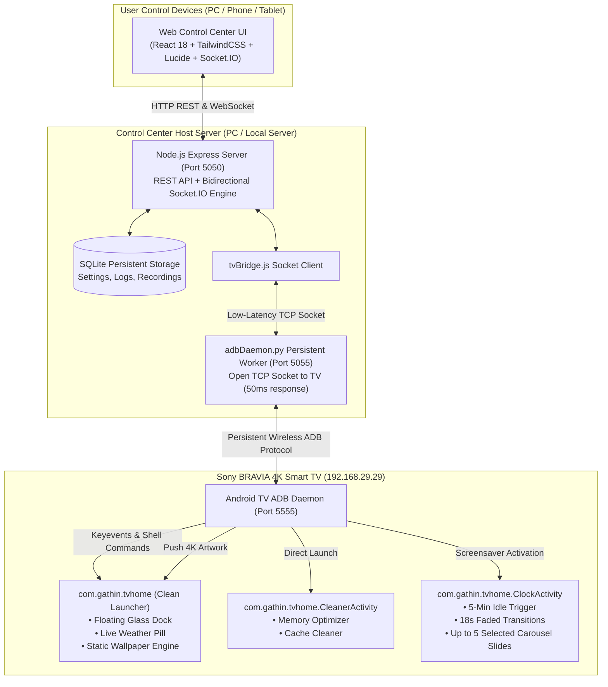

# Customize-TV-Interface-Command-Center-

An Apple TV-inspired minimalist interface, high-speed remote control system, and web-based command center for Android TV and Sony BRAVIA 4K Smart TVs.

Transform your television experience from an ad-bloated, sluggish stock dashboard into a fast, clean, ad-free glassmorphic launcher with sub-50ms wireless remote controls, dynamic 4K wallpapers, an auto-fading screensaver carousel, and a native TV cache cleaner.

---

## 🌟 Visual Showcase: Before & After

### The Transformation

| Stock Android TV / Google TV (Before) | Customize TV Command Center (After) |
| :--- | :--- |
| 🚫 Intrusive sponsored ads & video trailer autoplays | ✨ **Zero ads, 100% clean visual focus** |
| 🚫 Sluggish, heavy UI eating 1.3 GB+ RAM at idle | ⚡ **Ultra-lightweight native launcher with fluid 60 FPS spring physics** |
| 🚫 Generic, unchangeable cluttered home feed | 🎨 **Apple TV-styled floating glass dock with custom 4K wallpapers** |
| 🚫 Apps continuously accumulating cached junk | 🧹 **One-click on-TV Auto Cache & RAM Optimizer** |
| 🚫 Remote app limited to IR or slow TV manufacturer apps | 🕹️ **Persistent sub-50ms Web Remote & Automation Dashboard** |
| 🚫 Fixed screensaver with burn-in risk | 🌊 **Cinematic 5-Minute Inactivity Auto Carousel with smooth faded cross-fades** |

---

### Home Screen & Day/Night Themes

<div align="center">
  
  <p><em>Daytime: Mount Fuji Sunset 4K Wallpaper, live weather forecast, and floating glass dock with large focused dock title.</em></p>
</div>

<br/>

<div align="center">
  
  <p><em>Night Mode: Ambient twilight grade, dynamic time and evening weather pill with focused tile lighting.</em></p>
</div>

---

### On-TV Auto Cache Cleaner & Memory Optimizer

<div align="center">
  
  <p><em>One-click cleaner application natively accessible directly from your primary Home dock.</em></p>
</div>

<br/>

<div align="center">
  
  <p><em>Native Android TV optimization dialog: instantly releases RAM and frees background cache without logging you out of streaming services.</em></p>
</div>

<br/>

<div align="center">
  
  <p><em>Integrated fallback guide for clearing cache in protected system applications with one-click deep link to Android TV settings.</em></p>
</div>

---

## 🏗️ System Architecture



---

## ⚡ Core Features

### 1. Web-Based Smart TV Control Center
* **Instant Virtual Remote**: High-speed D-Pad, OK, Back, Home, Menu, Settings, Volume Up/Down/Mute, Power controls.
* **Persistent ADB Daemon**: Uses Python `adb_shell` over a persistent TCP daemon on port 5055, reducing keypress response latency to **<50ms**.
* **Voice Assistant Key Injection**: Triggers TV voice search and Google Assistant using native `KEYCODE_VOICE_ASSIST` (Keycode 231).
* **Live Screen Mirroring**: Captures high-res screen snapshots directly over ADB to monitor TV playback from any room.
* **Remote Shell Terminal**: Full interactive ADB shell console for running commands and inspecting Android system state.

### 2. Sony BRAVIA 4K Wallpaper Studio
* **Curated 4K Themes**: 10 hand-crafted photographic & digital wallpapers (*Mount Fuji Sunset, Northern Lights Aurora, Golden Coast, Autumn Valley, Cyberpunk Metropolis, etc.*).
* **Custom Photo Uploads**: Drag and drop any 4K image (.jpg, .png, .webp) from your PC to upload and push it to your TV screen within seconds.
* **Deterministic Display**: Applied wallpapers stay locked and persisted on your TV screen across reboots and power cycles without unexpected random rotation.

### 3. Auto Screen Carousel (5-Min Inactivity Screensaver)
* **Inactivity Auto-Start**: Automatically triggers after **5 minutes** of no remote button presses (`home_idle_clock_minutes: 5`).
* **Cinematic Faded Transitions**: Smoothly cross-fades between images every 18 seconds using hardware-accelerated dual-alpha animation (`alpha(0f)` $\to$ `alpha(1f)`).
* **Strict 5-Image Maximum**: Multi-select interface in the web dashboard strictly enforces a 5-image sequence limit.
* **Instant Preview & Remote Wake**: Preview the carousel on your TV with a single click in the dashboard; touch any button on your physical remote to instantly return to Home.

### 4. TV Memory Optimizer & Auto Cache Cleaner
* Built directly into the launcher dock as a native Leanback Android activity (`.CleanerActivity`).
* Safely trims background process memory and cleans app temporary cache files.
* Preserves user logins, app sessions, account credentials, and streaming watch history.

### 5. Audio & Voice Recording Studio
* Record notes, calls, or conversations through your browser microphone.
* Recordings are permanently stored on your local PC in `recordings/` and logged in an SQLite database with an integrated HTML5 web player.

---

## 🚀 Quickstart Guide

### Prerequisites
1. **Node.js** (v18 or higher)
2. **Python** (v3.9 or higher with virtualenv)
3. **Android TV** (Android 8.0 Pie or newer) with **Developer Options & ADB Debugging enabled**.

### 1. Clone & Setup
```bash
git clone https://github.com/AbheetHacker4278/Customize-TV-Interface-Command-Center-.git
cd Customize-TV-Interface-Command-Center-
```

### 2. Start the Control Center Server
Run the one-click startup script:
```powershell
powershell -ExecutionPolicy Bypass -File start_control_center.ps1
```

Or start manually:
```bash
cd server
npm install
node server.js
```

### 3. Access the Web Dashboard
* **Local Browser:** `http://localhost:5050`
* **Mobile / Local Network:** `http://<YOUR_PC_IP>:5050`
* **Default Dashboard Password:** `bravia2026`

---

## 📁 Repository Structure

```text
Customize-TV-Interface-Command-Center-/
├── client/                     # React 18 + TailwindCSS Frontend
│   ├── src/
│   │   ├── App.jsx             # Unified Web Dashboard & Navigation
│   │   ├── api.js              # Socket.IO & REST API client
│   │   └── main.jsx
│   ├── dist/                   # Production build assets
│   └── package.json
├── server/                     # Node.js + Express Backend
│   ├── server.js               # REST APIs & Socket.IO realtime server
│   ├── tvBridge.js             # High-speed persistent daemon client bridge
│   ├── tvService.js            # TV status monitor & state polling
│   ├── db.js                   # SQLite database (settings, logs, recordings)
│   ├── adbDaemon.py            # High-speed persistent Python ADB daemon
│   └── public/wallpapers/      # 4K Wallpaper presets & custom uploads
├── docs/images/                # UI screenshots, before/after captures
├── start_control_center.ps1    # One-click startup script
└── README.md
```

---

## 🙏 Credits & Shout-outs

Special thanks and shout-out to:
* **[drik98 / CleanYourTV](https://github.com/drik98/CleanYourTV)**: The wonderful open-source minimalist Android TV launcher that served as the foundational inspiration for our custom on-TV launcher components.
* The **adb-shell** open-source community for the Python ADB protocol implementation enabling sub-50ms wireless TV control.

---

## 📄 License

This project is licensed under the [MIT License](LICENSE).
